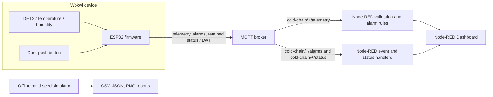

# Cold-Chain IoT Monitoring Gateway

An academic distributed-systems prototype for monitoring temperature-sensitive cargo. The project combines an ESP32 and DHT22 simulated in Wokwi, MQTT messaging with a Last Will and Testament (LWT), Node-RED validation and alarms, a live dashboard, and a reproducible offline Monte Carlo simulator.

**Authors:** Dener Kraus and Henrique Bueno de Morais

**Course:** DAS410103 - Basic Concepts of IoT and Distributed Systems

> This is a teaching prototype, not a validated cold-chain monitoring or safety system. Simulation metrics are synthetic estimates, not measurements from a physical device or network.

## Architecture



The firmware samples every 10 seconds, uses a 30-second MQTT keep-alive, and publishes temperature, relative humidity, door state, and uptime. The thermal compliance range is 2-8 C. Firmware and Node-RED independently evaluate temperature and door alarms; Node-RED routes its own alarm results directly to the dashboard, while firmware alarm events arrive over MQTT. Node-RED does not republish its locally detected alarms, which avoids MQTT echo loops.

For abrupt loss of the device connection, its MQTT CONNECT packet registers a retained QoS 1 `offline` LWT on `cold-chain/<device_id>/status`. The broker normally detects a missing client after up to 1.5 times the keep-alive interval (45 seconds for this configuration); the actual delay depends on broker and network behavior.

Detailed function call paths, message shapes, design decisions, and per-directory notes are in [`docs/architecture.md`](docs/architecture.md) and each implementation directory's `README.md`. The [`DEVELOPMENT.md`](DEVELOPMENT.md) file preserves the project's design and change history for future maintainers and AI coding assistants.

## Install from a clean Windows computer

The commands below assume Windows 10/11, PowerShell, and `winget`. Install the three required tools from an elevated or regular PowerShell terminal:

```powershell
winget install --exact --id Git.Git
winget install --exact --id Python.Python.3.12
winget install --exact --id Docker.DockerDesktop
```

Restart PowerShell after installation. Start Docker Desktop and complete its first-run WSL 2 setup if prompted. If WSL is not installed, run the following command from an elevated PowerShell terminal and restart Windows:

```powershell
wsl --install
```

From the project directory, create and activate a virtual environment and install Python dependencies:

```powershell
py -3.12 -m venv .venv
.\.venv\Scripts\Activate.ps1
python -m pip install --upgrade pip
python -m pip install -r requirements.txt
```

If PowerShell blocks activation, allow it for the current terminal only and activate again:

```powershell
Set-ExecutionPolicy -Scope Process -ExecutionPolicy Bypass
.\.venv\Scripts\Activate.ps1
```

Git is needed to clone this repository. Docker Desktop is only required to run the local MQTT broker and Node-RED; the offline simulator only requires Python and its dependencies.

## Run simulations

Run one deterministic trial (the default) and its tests:

```powershell
python -m simulation.run_simulation
python -m unittest discover -s tests -v
```

Run multiple independent trials with sequential seeds, for example 100 replications starting at seed 410103:

```powershell
python -m simulation.run_simulation --seed 410103 --runs 100
```

`--runs` is the number of independent pseudorandom trials; trial `i` uses seed `--seed + i`. More runs generally give a more stable estimate of variability, at the cost of more computation. The reported 95% intervals are normal approximations based on the sample standard deviation; they are descriptive and may be imprecise with small sample counts. A single run reports no confidence interval. Results can differ if the model or its constants change, even when the seed is unchanged.

Available options:

```powershell
python -m simulation.run_simulation --help
python -m simulation.run_simulation --seed 123 --runs 25 --output-dir reports
```

The simulator advances one synthetic hour without waiting an hour in real time. It models telemetry until a device disconnects at 3,000 simulated seconds, a 1% message-drop probability, network latency, a thermal excursion, an open door, and estimated LWT detection. These are modeled conditions, not measurements from a real MQTT broker.

The output directory contains:

| File | Contents |
| --- | --- |
| `telemetry.csv` | Received samples from the first trial |
| `events.json` | First-trial thermal, door, and LWT events |
| `simulation_metrics.json` | First-trial delivery, latency, and alarm metrics |
| `performance_overview.png` | Temperature, compliance band, door-open periods, MQTT latency, alarms, and disconnect time |
| `system_performance.png` | First-trial latency, delivery, and LWT estimates |
| `seed_sweep_metrics.json` | Per-metric means, per-seed values, sample deviations, and approximate intervals |
| `seed_sweep_performance.png` | Histograms of delivery and latency metrics across seeds |

`--output-dir` is created if needed. Running again replaces matching generated report files in that directory.

The checked-in 100-seed example (base seed `410103`) produced a mean delivery ratio of **98.9796%** (approximate 95% interval: **98.8564-99.1028%**), mean network latency of **77.5784 ms** (approximate interval: **77.2740-77.8828 ms**), and mean network P95 latency of **115.8451 ms**. These values summarize this synthetic model only; they are not real-network benchmarks.

## Run the local MQTT broker and Node-RED

Start Docker Desktop, then start the services from the project root:

```powershell
docker compose up -d
docker compose ps
```

Open the Node-RED editor at `http://localhost:1880` and the dashboard at `http://localhost:1880/ui`. The initial flow is [`node-red/flows.json`](node-red/flows.json), and Node-RED loads Dashboard from [`node-red/package.json`](node-red/package.json).

Stop the services with:

```powershell
docker compose down
```

The local Mosquitto listener and Node-RED web interface bind to `127.0.0.1`. Anonymous MQTT access is intentionally limited to this local teaching setup; do not expose this broker to a network or the Internet.

## Run the ESP32 in Wokwi

1. Create an ESP32 project at [Wokwi](https://wokwi.com/projects/new/esp32).
2. Copy [`wokwi/sketch.ino`](wokwi/sketch.ino) and [`wokwi/diagram.json`](wokwi/diagram.json) into the project.
3. Add the libraries listed in [`wokwi/libraries.txt`](wokwi/libraries.txt).
4. Start the simulation. Change DHT22 values to exercise temperature alarms; press `D` to operate the door input.

The example firmware uses the public `broker.hivemq.com` broker on port 1883 without TLS or authentication. The local Compose stack uses its own Mosquitto instance and is **not automatically connected** to Wokwi. For a live dashboard demonstration, configure the Node-RED MQTT broker node to use the same accessible broker and port as the firmware, or use a properly secured broker that both clients can reach. The `mosquitto` hostname only resolves inside the Compose network. Never publish sensitive or production data to a public demo broker.

The firmware uses `PubSubClient`, which publishes telemetry at QoS 0; a QoS 1 subscription cannot raise the publisher's delivery guarantee.

## Suggested presentation outline

1. Explain the distributed architecture, device identifier, and MQTT topic structure.
2. Show DHT22 readings and door events in Wokwi.
3. Walk through Node-RED validation, rule evaluation, and dashboard paths.
4. Compare the reproducible synthetic performance charts and discuss their limitations.
5. Stop the Wokwi client abruptly and observe the retained offline LWT status.
6. Divide implementation and demonstration time evenly between both authors.
