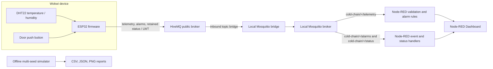

# Cold-Chain IoT Monitoring Gateway

An academic distributed-systems prototype for monitoring temperature-sensitive cargo. The project combines an ESP32 and DHT22 simulated in Wokwi, MQTT messaging with a Last Will and Testament (LWT), Node-RED validation and alarms, a live dashboard, and a reproducible offline Monte Carlo simulator.

**Authors:** Dener Kraus and Henrique Bueno de Morais

**Course:** DAS410103 - Basic Concepts of IoT and Distributed Systems

> This is a teaching prototype, not a validated cold-chain monitoring or safety system. Simulation metrics are synthetic estimates, not measurements from a physical device or network.

> **Live integration status:** The DHT22 wiring/library fix was checked with the sensor-only Wokwi diagnostic (5.00 C / 55.00%). In a later full-firmware run using Wokwi's Public Gateway, a local Mosquitto subscriber captured three Wokwi-originated MQTT samples (5.00 C, 55.00%, door closed; uptimes 92, 102, and 112 seconds), and Node-RED displayed 5 C / 55% with the gateway online. After stopping the simulation, the dashboard and retained status showed offline; the exact LWT detection delay was not measured. This confirms a short end-to-end run, not long-duration reliability. Three subsequent restart attempts remained at `Connecting to Wi-Fi` for approximately 10--15 seconds and were stopped without additional telemetry; the cause is unresolved. The Pro-only Private Gateway was not used: Wokwi displayed an upgrade prompt when it was enabled, so the verified run used the documented public-broker path.

## Architecture



The firmware samples every 10 seconds, uses a 30-second MQTT keep-alive, and publishes temperature, relative humidity, door state, and uptime. The thermal compliance range is 2-8 C. Firmware and Node-RED independently evaluate temperature and door alarms; Node-RED routes its own alarm results directly to the dashboard, while firmware alarm events arrive over MQTT. Node-RED does not republish its locally detected alarms, which avoids MQTT echo loops.

The free end-to-end route uses HiveMQ as the public rendezvous broker: Wokwi
publishes there, a narrowly scoped **inbound-only** Mosquitto bridge copies this
project's messages to the local broker, and Node-RED continues to consume the
local broker. This avoids paying for Wokwi's private gateway and keeps the
local Mosquitto listener off the Internet. This is a classroom workaround, not
a secure or production network.

For abrupt loss of the device connection, its MQTT CONNECT packet registers a retained QoS 1 `offline` LWT on `cold-chain/<device_id>/status`. The broker normally detects a missing client after up to 1.5 times the keep-alive interval (45 seconds for this configuration); the actual delay depends on broker and network behavior.

Detailed function call paths, message shapes, design decisions, and per-directory notes are in [`docs/architecture.md`](docs/architecture.md) and each implementation directory's `README.md`. The [`docs/defense-preparation.md`](docs/defense-preparation.md) file contains likely presentation questions and evidence-based answers. The [`DEVELOPMENT.md`](DEVELOPMENT.md) file preserves the project's design and change history for future maintainers and AI coding assistants.

## Installation and Environment Setup

### Windows (PowerShell)

The commands below assume Windows 10/11, PowerShell, and `winget`. Install the three required tools from an elevated or regular PowerShell terminal:

```powershell
winget install --exact --id Git.Git
winget install --exact --id Python.Python.3.12
winget install --exact --id Docker.DockerDesktop
```

Restart PowerShell after installation. Start Docker Desktop and complete its first-run WSL 2 setup if prompted. If WSL is not installed, run the following command from an elevated PowerShell terminal and restart Windows:

```powershell
wsl --install
```

From the project directory, create and activate a virtual environment and install Python dependencies:

```powershell
py -3.12 -m venv .venv
.\.venv\Scripts\Activate.ps1
python -m pip install --upgrade pip
python -m pip install -r requirements.txt
```

If PowerShell blocks activation, allow it for the current terminal only and activate again:

```powershell
Set-ExecutionPolicy -Scope Process -ExecutionPolicy Bypass
.\.venv\Scripts\Activate.ps1
```

### Linux (Fedora / Ubuntu / Debian / Arch)

Running the offline simulator on Linux requires only Python 3 (3.10+) and `venv`. Docker is optional and only required if you run the local MQTT broker and Node-RED stack.

#### 1. Install system prerequisites

- **Fedora:**
  ```bash
  sudo dnf install -y git python3 python3-pip
  ```
- **Ubuntu / Debian:**
  ```bash
  sudo apt update && sudo apt install -y git python3 python3-pip python3-venv
  ```
- **Arch Linux:**
  ```bash
  sudo pacman -S --needed git python python-pip
  ```

#### 2. Virtual environment setup

From the project root directory:

```bash
python3 -m venv .venv
source .venv/bin/activate
pip install --upgrade pip
pip install -r requirements.txt
```

#### 3. Optional: Docker setup for local Mosquitto & Node-RED

If you plan to run the live MQTT broker and Node-RED dashboard locally on Linux, install Docker CE or Docker Compose. After package installation, enable the Docker daemon and add your user to the `docker` group so you can run Docker without `sudo`:

```bash
# Enable and start the Docker systemd service
sudo systemctl enable --now docker

# Add current user to the docker group
sudo usermod -aG docker $USER

# Apply group changes to your current shell session (or log out and back in)
newgrp docker
```

## Run simulations

Once your virtual environment is active (via `source .venv/bin/activate` on Linux or `.\.venv\Scripts\Activate.ps1` on Windows), run one deterministic trial (the default) and its tests:

```bash
python -m simulation.run_simulation
python -m unittest discover -s tests -v
```

Run multiple independent trials with sequential seeds, for example 100 replications starting at seed 410103:

```bash
python -m simulation.run_simulation --seed 410103 --runs 100
```

`--runs` is the number of independent pseudorandom trials; trial `i` uses seed `--seed + i`. More runs generally give a more stable estimate of variability, at the cost of more computation. The reported 95% intervals are normal approximations based on the sample standard deviation; they are descriptive and may be imprecise with small sample counts. Since these metrics are non-negative, a negative lower endpoint is clipped to zero. A single run reports no confidence interval. Results can differ if the model or its constants change, even when the seed is unchanged.

Run the additional packet-loss and MQTT keep-alive analyses with:

```bash
python -m simulation.run_simulation --seed 410103 --runs 100 --sensitivity-analysis
```

The sensitivity run compares message-drop probabilities of 0%, 1%, 5%, and 10%, plus theoretical Last Will delays for 10-, 20-, 30-, and 60-second keep-alives. Use `--drop-rate 0.05` to change the regular seed sweep's modeled drop probability; this does not change the fixed sensitivity scenarios.

Available options:

```bash
python -m simulation.run_simulation --help
python -m simulation.run_simulation --seed 123 --runs 25 --output-dir reports
python -m simulation.run_simulation --seed 123 --runs 25 --drop-rate 0.05
```

The simulator advances one synthetic hour without waiting an hour in real time. It models telemetry until a device disconnects at 3,000 simulated seconds, a 1% message-drop probability, network latency, a thermal excursion, an open door, and estimated LWT detection. These are modeled conditions, not measurements from a real MQTT broker.

The output directory contains:

| File | Contents |
| --- | --- |
| `telemetry.csv` | Received samples from the first trial |
| `events.json` | First-trial thermal, door, and LWT events |
| `simulation_metrics.json` | First-trial delivery, latency, and alarm metrics |
| `performance_overview.png` | Temperature, compliance band, door-open periods, MQTT latency, alarms, and disconnect time |
| `system_performance.png` | First-trial latency, delivery, and LWT estimates |
| `seed_sweep_metrics.json` | Per-metric means, per-seed values, sample deviations, and approximate intervals, including operational alarm metrics |
| `seed_sweep_performance.png` | Histograms of delivery and latency metrics across seeds, with mean and approximate confidence interval |
| `alarm_response_analysis.png` | Distributions of temperature and door alarm response delays and observed thermal exposure |
| `network_sensitivity_metrics.json` | Delivery, event-window coverage, alarm detection, and response metrics at each packet-loss scenario |
| `network_loss_sensitivity.png` | The effect of packet loss on overall delivery, excursion-window coverage, and alarm delay |
| `lwt_keepalive_sensitivity.json` | Keep-alive settings and formula-based Last Will detection estimates |
| `lwt_keepalive_sensitivity.png` | The theoretical relationship between MQTT keep-alive and Last Will detection delay |

`--output-dir` is created if needed. Running again replaces matching generated report files in that directory.

### Reading the seed-sweep chart

Each histogram bar counts seeds (trials), not individual MQTT messages. Each seed contributes one delivery percentage, one average latency, and one per-trial P95 latency. The dashed line is the mean across seeds; the shaded band is an approximate 95% confidence interval for that mean. In particular, P95 is the 95th percentile of message latency within a trial; it is not the confidence interval.

The checked-in 100-seed example (base seed `410103`) produced a mean delivery ratio of **98.9796%** (approximate 95% interval: **98.8564-99.1028%**), mean network latency of **77.5784 ms** (approximate interval: **77.2740-77.8828 ms**), and mean per-trial network P95 latency of **115.8451 ms**. These values summarize this synthetic model only; they are not real-network benchmarks.

The thermal compliance percentage includes delivered sensor samples only. Excursion degree-minutes are a trapezoidal estimate over contiguous received samples; intervals with packet gaps are omitted rather than inferred. Alarm detection delays are measured from the injected temperature excursion start or from the door alarm threshold, as labeled. Last Will sensitivity uses the theoretical `1.5 x keep-alive` estimate and must not be presented as a measured broker response.

The [reports guide](reports/README.md) explains each chart and gives a practical interpretation of the generated 100-seed findings.

## Run the local MQTT broker and Node-RED

Start Docker Desktop (Windows) or the Docker daemon (Linux via `sudo systemctl start docker`), then start the services from the project root:

```bash
docker compose up -d --build
docker compose ps
```

Open the Node-RED editor at `http://localhost:1880` and the dashboard at `http://localhost:1880/ui`. The initial flow is [`node-red/flows.json`](node-red/flows.json), and Node-RED loads Dashboard from [`node-red/package.json`](node-red/package.json).

Stop the services with:

```bash
docker compose down
```

The local Mosquitto listener and Node-RED web interface bind to `127.0.0.1`. Anonymous MQTT access is intentionally limited to this local teaching setup; do not expose this broker to a network or the Internet.

## Run the ESP32 in Wokwi

1. Open the saved [Cold Chain IoT Gateway Wokwi project](https://wokwi.com/projects/481333516199647233), or create a project at [Wokwi](https://wokwi.com/projects/new/esp32).
2. If creating a new project, copy [`wokwi/sketch.ino`](wokwi/sketch.ino) and [`wokwi/diagram.json`](wokwi/diagram.json), then add the libraries in [`wokwi/libraries.txt`](wokwi/libraries.txt).
3. Start the simulation. Change DHT22 values to exercise temperature alarms; press `D` to operate the door input. The Serial Monitor reports Wi-Fi and MQTT connection attempts.

To isolate the Wokwi Wi-Fi and public-gateway route from MQTT and Node-RED, see [`wokwi/network-diagnostic/README.md`](wokwi/network-diagnostic/README.md).

The example firmware uses the public `broker.hivemq.com` broker on port 1883
without TLS or authentication. The local Mosquitto bridge subscribes only to
`cold-chain/esp32-ccgw-dk-hb/#` and forwards those messages to the local
Node-RED broker. Therefore, leave the Node-RED broker host as `mosquitto`; no
paid Wokwi feature or broker edit in the Node-RED editor is needed. The public
broker and Wokwi Public Gateway are shared services and the MQTT traffic is
unencrypted. Use only the synthetic demonstration data; never send sensitive
or production data.

## Run the complete free demonstration

1. Start Docker Desktop (Windows) or the Docker daemon (Linux via `sudo systemctl start docker`), then run `docker compose up -d` from the repository root.
2. Check `docker compose ps`; then use `docker compose logs -f mosquitto` to
   confirm that the `cold-chain-public-demo` bridge connected to HiveMQ.
3. Open `http://localhost:1880/ui` for the Node-RED dashboard.
4. Start the Wokwi ESP32 project. Keep the Wokwi browser window visible in the foreground (e.g., side-by-side with Node-RED) to prevent browser background-tab throttling from interrupting the simulated MQTT keep-alive loop. Verify that telemetry updates the gauges and charts, and that alarm and status messages reach the dashboard through HiveMQ -> Mosquitto bridge -> local Mosquitto -> Node-RED.
5. Stop the Wokwi simulation abruptly to exercise the device's LWT. The broker
   should report `offline`; allow up to about 45 seconds for the configured
   30-second keep-alive detection estimate.

The public broker is not under the project's control, so this demonstration
depends on its availability and may be affected by other users. For a
broker-isolated demonstration, Wokwi's Private IoT Gateway can reach local
services, but that feature requires a paid Wokwi plan.

The firmware uses `PubSubClient`, which publishes telemetry at QoS 0; a QoS 1 subscription cannot raise the publisher's delivery guarantee.

If Wokwi displays `WiFi Error: Connection to IoT Gateway wss://netwi.wokwi.com/ failed` or a WebSocket HTTP 503, record the simulator output and time, then run the isolated test in [`wokwi/network-diagnostic/README.md`](wokwi/network-diagnostic/README.md). A 503 is evidence that the gateway WebSocket request failed at that time; it does not, by itself, establish a persistent Wokwi outage or rule out other causes. Compare the simulated device's Wi-Fi, TCP, MQTT, and application-level results before attributing the failure. The Public Gateway is a shared service and its availability is not controlled by this project.

For DHT22 wiring and sensor-driver checks independent of Wi-Fi/MQTT, use [`wokwi/dht-diagnostic/README.md`](wokwi/dht-diagnostic/README.md).

## Suggested presentation outline

1. Explain the distributed architecture, device identifier, and MQTT topic structure.
2. Show DHT22 readings and door events in Wokwi.
3. Walk through Node-RED validation, rule evaluation, and dashboard paths.
4. Compare the reproducible synthetic performance charts and discuss their limitations.
5. Stop the Wokwi client abruptly and observe the retained offline LWT status.
6. Divide implementation and demonstration time evenly between both authors.
