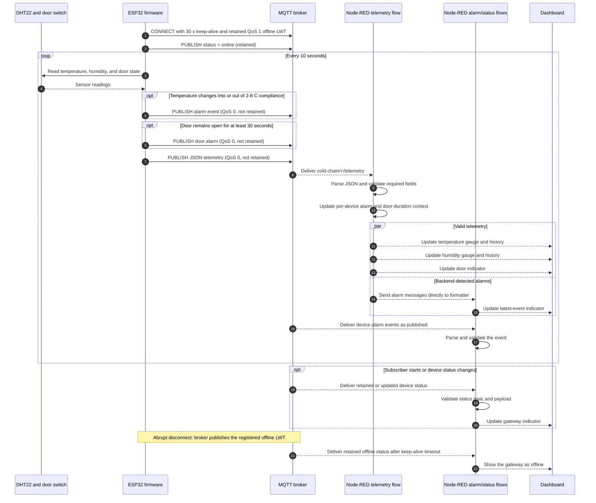
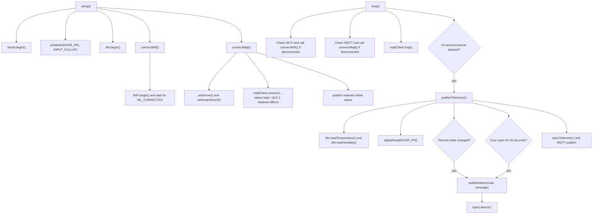
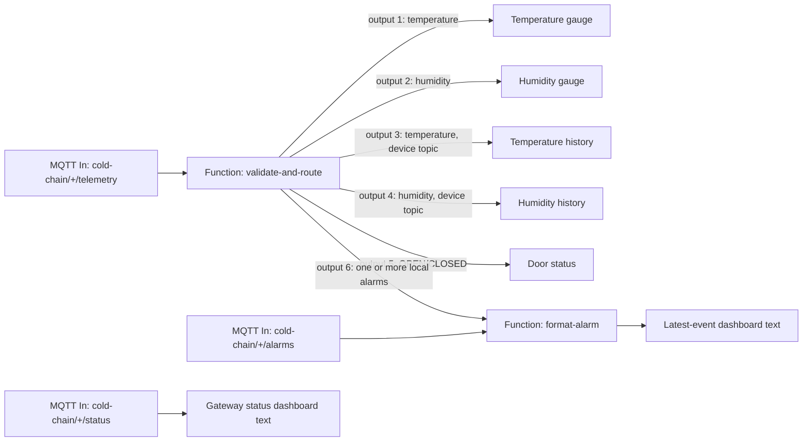
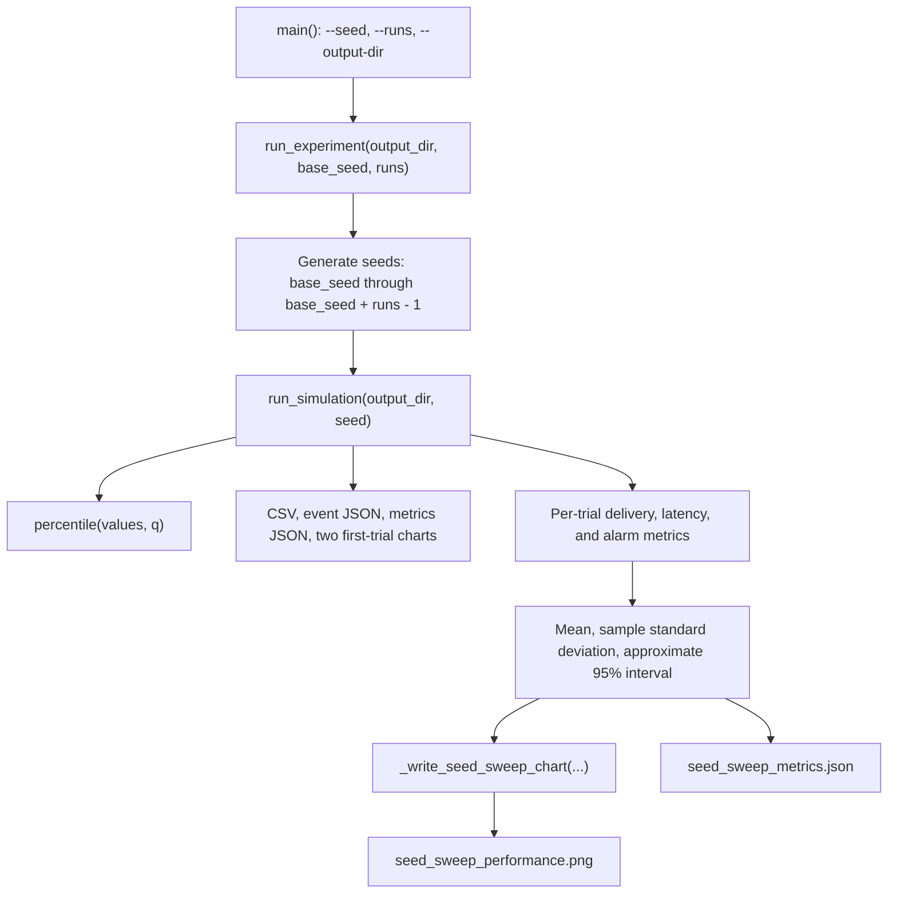

# Architecture and Function Call Paths

This document explains how component functions exchange messages. Names and payload fields are part of the teaching prototype's interface; update the firmware, Node-RED flow, simulator, tests, and docs together if that interface changes.

## End-to-end sequence



The local Node-RED MQTT configuration subscribes to the same status, telemetry, and alarm topics. It intentionally does not configure its own birth, close, or will messages on the device's status topic: only the device knows whether that device is online.

## Firmware call graph



| Function | Inputs / state | Side effects and caller |
| --- | --- | --- |
| `topic(suffix)` | A topic suffix and the fixed device identifier | Returns a `cold-chain/<device_id>/<suffix>` string to MQTT publishers. |
| `connectWifi()` | Wi-Fi credentials | Blocks until the simulator's Wi-Fi is connected; called from `setup()` and `loop()`. |
| `connectMqtt()` | Configured MQTT client and device identifier | Configures keep-alive, connects with a retained QoS 1 offline will, then publishes retained online status. Called at startup and after disconnect. |
| `publishAlarm(code, message)` | Alarm identifier and English description | Encodes a JSON event and publishes to the non-retained alarm topic at the client's publish QoS. Called by sensor rules. |
| `publishTelemetry()` | DHT22 values, digital door pin, elapsed uptime | Tracks door-open duration and thermal state, emits any transition alarms, then publishes one JSON sample. |
| `setup()` | ESP32 startup | Initializes serial, input pin, DHT22, Wi-Fi, and MQTT once. |
| `loop()` | Arduino scheduler | Restores Wi-Fi/MQTT if needed, services MQTT keep-alive, and schedules telemetry. |

## MQTT contract

| Topic | Publisher | Payload | QoS / retain |
| --- | --- | --- | --- |
| `cold-chain/<device_id>/telemetry` | ESP32 | `device_id`, `temperature_c`, `humidity_pct`, `door_open`, `uptime_s` | Firmware publishes QoS 0, not retained |
| `cold-chain/<device_id>/alarms` | ESP32 | `device_id`, `code`, `message` | Firmware publishes QoS 0, not retained |
| `cold-chain/<device_id>/status` | ESP32 and its broker will | `online` or `offline` | QoS 1, retained |

The Node-RED subscription requests QoS 1, but MQTT delivery cannot exceed the publisher's QoS. The Python simulator uses a separate synthetic CSV/JSON schema and never publishes to a broker.

Example firmware telemetry payload:

```json
{
  "device_id": "esp32-cold-chain",
  "temperature_c": 5.0,
  "humidity_pct": 55.0,
  "door_open": false,
  "uptime_s": 10
}
```

Example device alarm payload:

```json
{
  "device_id": "esp32-cold-chain",
  "code": "temperature_excursion",
  "message": "Temperature outside the 2 to 8 C range"
}
```

Backend-detected dashboard events add a UTC `timestamp`; the device alarm payload intentionally remains a small event record.

## Node-RED call/data-flow



`validate-and-route` parses a JSON string when necessary, rejects invalid JSON and missing/incorrect sensor fields, then emits five dashboard data messages. Its per-device Node-RED context stores the previous thermal alarm state, door-open timestamp, and whether an open-door alarm was already raised. It emits an alarm only on a thermal state transition or the first telemetry sample observed after the 30-second door threshold. If both rules trigger on one sample, output 6 contains both alarm messages.

Backend alarm messages go from output 6 directly to `format-alarm`; they are not published to MQTT. Device-originated alarm messages arrive independently through the alarm subscription. `format-alarm` accepts either a decoded JSON object or a JSON string, validates its `code` and `message`, and formats the last-event widget. `gateway-status` displays the device identifier from the topic and the retained status payload.

## Offline simulation and aggregation flow



`run_simulation` uses a local seeded pseudo-random generator and writes full detailed artifacts for one trial. `run_experiment` runs later seeds in temporary directories, preserving the first trial as a detailed example while aggregating all trials. `percentile` uses the nearest-rank definition; the seed-sweep interval uses `mean +/- 1.96 * sample_standard_deviation / sqrt(n)` and is explicitly approximate.

## Cross-component change checklist

When modifying sensor fields or topic names, update each relevant item:

1. Firmware payload construction and topic helper usage in `wokwi/sketch.ino`.
2. Node-RED topic subscriptions, validation, routes, and dashboard labels in `node-red/flows.json`.
3. Simulator sample/event records and metric aggregation in `simulation/run_simulation.py`.
4. Assertions in `tests/test_simulation.py`.
5. The MQTT table above, the root README, and affected component `README.md` files.
