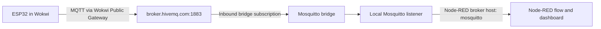

# Mosquitto Broker and MQTT Bridge

The Compose stack runs Mosquitto as the local MQTT broker used by Node-RED.
The free Wokwi Public Gateway cannot connect directly to services on the
developer's computer, so Mosquitto also opens an outbound MQTT bridge to the
public HiveMQ demonstration broker. The bridge subscribes only to this
project's device namespace and forwards matching messages into the local broker.



## Configuration and message path

`mosquitto.conf` keeps a persistent listener on port 1883 and permits
anonymous local clients. Docker Compose publishes the host port only on
`127.0.0.1`. Other Compose services reach the listener at `mosquitto:1883`.

The outbound `cold-chain-public-demo` bridge:

- Connects to `broker.hivemq.com:1883` using MQTT 3.1.1.
- Subscribes **inbound only** to `cold-chain/esp32-ccgw-dk-hb/#`.
- Requests QoS 1, but does not upgrade messages published at QoS 0.
- Retries the remote connection automatically.
- Does not publish local Node-RED messages to HiveMQ.

The MQTT host in the Wokwi sketch, the bridge's topic filter, and the device
ID must stay aligned. Node-RED remains configured for the local Compose broker;
no broker changes are needed in the flow editor.

## Start and verify

From the repository root, run:

```powershell
docker compose up -d --build
docker compose ps
docker compose logs -f mosquitto
```

The log should show a connection attempt for `cold-chain-public-demo`. Verify
the HiveMQ-to-local bridge independently by running these commands in two
PowerShell terminals. The first waits for one message on the local broker:

```powershell
docker compose exec -T mosquitto mosquitto_sub -h 127.0.0.1 -t "cold-chain/esp32-ccgw-dk-hb/bridge-check" -v -C 1 -W 20
```

The second publishes a synthetic message to HiveMQ; the inbound bridge should
forward it to the first terminal:

```powershell
docker compose exec -T mosquitto mosquitto_pub -h broker.hivemq.com -p 1883 -t "cold-chain/esp32-ccgw-dk-hb/bridge-check" -q 1 -m '{"origin":"manual-bridge-check","device_id":"esp32-ccgw-dk-hb"}'
```

After that check, open the dashboard at `http://localhost:1880/ui` and start
the Wokwi simulation. On a working public gateway, the dashboard should
receive telemetry, alarms, and retained availability through local Mosquitto.
Stop the Wokwi simulation abruptly to observe the Last Will status change;
allow up to about 45 seconds for the 30-second keep-alive timeout estimate.

During the latest live check, Wokwi compiled and booted but its Public Gateway
WebSocket returned HTTP 503, so no ESP32 telemetry or LWT reached the
dashboard. The synthetic bridge check above passed independently. Do not
describe the full live path as verified until telemetry and LWT are observed
from the Wokwi device itself.

## Security and scope

This is a free academic demonstration, not a secure deployment. HiveMQ and the
Wokwi Public Gateway are shared services; the connection uses plaintext port
1883 without authentication, and public-gateway traffic may be monitored. The
unique topic namespace reduces accidental collisions but does not provide
access control or confidentiality. Use only synthetic, non-sensitive data.
The local Mosquitto port is bound to `127.0.0.1` and is not exposed to the LAN
or Internet.

## Change history

- Initial prototype: created a persistent local MQTT 3.1.1 listener for the Compose stack.
- Free end-to-end route: added a namespace-limited inbound bridge so Wokwi's public gateway can reach local Node-RED without exposing Mosquitto.
