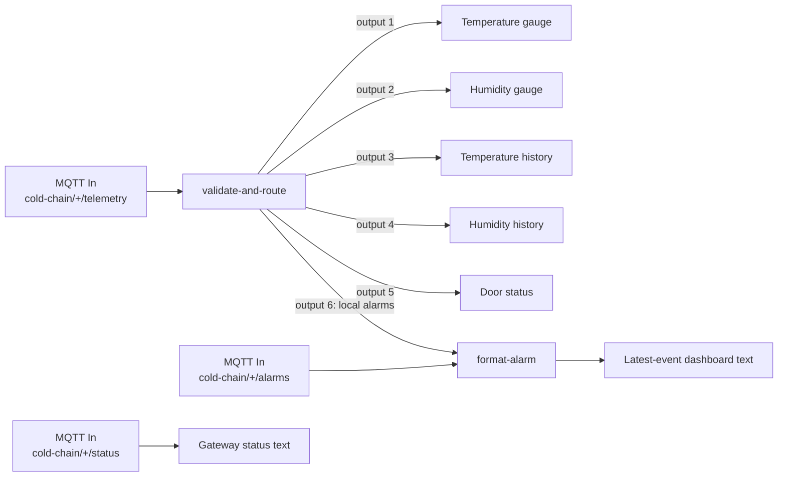

# Node-RED Flows

`flows.json` contains the Node-RED workspace tab, MQTT broker reference, subscriptions, validation and alarm function nodes, Dashboard gauges/charts/text widgets, and dashboard tab/group. `package.json` installs the legacy `node-red-dashboard` package used by the flow.

## Startup and broker configuration

Docker Compose mounts this directory at `/data` and sets `FLOWS=flows.json`. Start the stack with `docker compose up -d`, edit flows at `http://localhost:1880`, and view the dashboard at `http://localhost:1880/ui`.

The default broker host is `mosquitto`, which is the Docker Compose service name. It is not reachable directly from Wokwi. For a live hosted-simulator demonstration, edit the MQTT broker configuration in the Node-RED editor so it points to the same broker host and port used by the sketch. Do not use a public demo broker for sensitive data.

## Flow responsibilities

- Telemetry input subscribes to `cold-chain/+/telemetry`.
- `validate-and-route` parses and validates telemetry, fans out five dashboard
  updates, applies per-device thermal/door rules, and forwards local alarms
  directly to the formatter.
- Alarm input subscribes to firmware events on `cold-chain/+/alarms`.
- `format-alarm` validates and normalizes device or backend alarms for the
  latest-event widget.
- Status input subscribes to retained `cold-chain/+/status` and displays the publisher status.

Backend-generated alerts are deliberately not republished through MQTT; direct routing avoids a broker echo loop. Device-generated alerts remain on MQTT. Both rule evaluators can independently report the same physical condition.

## Function-node call and message flow

### `validate-and-route`

- **Input:** one decoded telemetry object or JSON string, plus its MQTT topic.
- **Validation:** requires an identifiable device, finite temperature and
  humidity numbers, and a boolean door state. Malformed JSON or invalid fields
  produce a Node-RED warning and no outputs.
- **State:** context keys are device-scoped and retain thermal alarm state,
  first observed open-door time, and whether the 30-second door alarm fired.
- **Outputs:** outputs 1-5 update the two gauges, two history charts, and door
  indicator. Output 6 carries zero, one, or multiple locally generated alarms.
- **Caller/callee relationship:** the telemetry MQTT input calls this node via
  its wire; its sixth output connects directly to `format-alarm`. It does not
  republish backend alarms to the broker.

### `format-alarm`

- **Input:** a device alarm from the alarm MQTT subscription or a backend alert
  from output 6 of `validate-and-route`.
- **Validation and result:** parses a JSON string when needed, requires `code`
  and `message`, then changes the input message payload to `code: message`.
  Invalid alarm objects generate a warning and are dropped.
- **Output:** the same message is returned to the latest-event dashboard text
  widget; the function does not publish to MQTT.

## Change history

- Initial prototype: added MQTT broker, dashboard widgets, sensor checks, and MQTT alarm subscriptions.
- English documentation pass: translated dashboard and validation messages.
- Reliability correction: removed Node-RED's birth/close/will publications from the ESP32 status topic; only the ESP32 should report its own liveness.
- Reliability correction: routed local rule alarms straight to the dashboard and preserve simultaneous thermal and door alerts.
