# Simulation Tests

`test_simulation.py` uses Python's built-in `unittest` framework and temporary
directories. The focused tests cover:

- `test_simulation_emits_alarm_events_and_performance_artifacts`: event detection,
  metric bounds, and single-trial files.
- `test_simulation_is_reproducible_with_same_seed`: stable metrics across two runs.
- `test_seed_sweep_aggregates_independent_runs`: seed enumeration, mean,
  confidence interval, and aggregate charts.
- `test_seed_sweep_rejects_non_positive_run_count` and
  `test_single_seed_sweep_omits_confidence_interval`: invalid and one-run edges.
- `test_zero_drop_rate_delivers_all_generated_messages` and
  `test_simulation_rejects_invalid_drop_rates`: packet-loss boundaries.
- `test_non_negative_metric_confidence_interval_does_not_cross_zero`: aggregate
  interval clipping.
- `test_sensitivity_analysis_writes_network_and_lwt_results`: network scenarios,
  LWT formula estimate, and report files.

Run the suite from the repository root with `python -m unittest discover -s tests -v`.

## Test-to-code call graph

```mermaid
flowchart TD
    ArtifactTest["test_simulation_emits_alarm_events_and_performance_artifacts"] --> Simulation["run_simulation()"]
    ReproTest["test_simulation_is_reproducible_with_same_seed"] --> Simulation
    SeedTest["test_seed_sweep_aggregates_independent_runs"] --> Experiment["run_experiment()"]
    InvalidRunTest["test_seed_sweep_rejects_non_positive_run_count"] --> Experiment
    SingleSeedTest["test_single_seed_sweep_omits_confidence_interval"] --> Experiment
    ZeroDropTest["test_zero_drop_rate_delivers_all_generated_messages"] --> Simulation
    DropValidationTest["test_simulation_rejects_invalid_drop_rates"] --> Simulation
    DropValidationTest --> Experiment
    IntervalTest["test_non_negative_metric_confidence_interval_does_not_cross_zero"] --> Aggregate["_aggregate_metric()"]
    SensitivityTest["test_sensitivity_analysis_writes_network_and_lwt_results"] --> Sensitivity["run_sensitivity_analysis()"]

    Experiment --> Simulation
    Experiment --> Aggregate
    Sensitivity --> Simulation
    Sensitivity --> Aggregate
    Simulation --> Artifacts["events, metrics, CSV, and single-run charts"]
    Experiment --> SweepArtifacts["seed summary and seed/alarm charts"]
    Sensitivity --> SensitivityArtifacts["network/LWT summaries and charts"]
```

Each test calls public simulation entry points or the one aggregation helper
whose edge behavior is under test. Temporary directories isolate generated
files; the diagram's artifact nodes summarize what the tests assert rather
than additional callable functions.

## Change history

- Initial prototype: checked single-seed event generation, reproducibility, and core artifacts.
- Multi-seed analysis: checked seed selection, aggregate calculations, chart output, and invalid run counts.
- English documentation pass: documented each test's behavior and kept assertions aligned with the English report schema.
