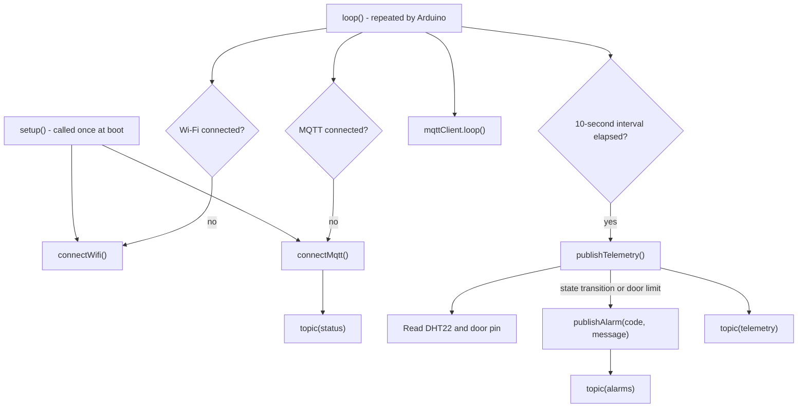

# Wokwi ESP32 Device

This directory contains the simulated board wiring (`diagram.json`), firmware (`sketch.ino`), and required Arduino libraries (`libraries.txt`). The ESP32 uses GPIO 15 for the DHT22 data line and GPIO 27 for the door push button; the button is read with `INPUT_PULLUP`.

## Wokwi setup

1. Create an ESP32 project at `https://wokwi.com/projects/new/esp32`.
2. Copy `sketch.ino` and `diagram.json` into the project.
3. Install each library listed in `libraries.txt`.
4. Run the simulation, adjust the DHT22 temperature or humidity, and press `D` to open or close the door.

The default sketch connects to `broker.hivemq.com:1883` with no TLS or authentication. Configure the Node-RED MQTT broker to use the same reachable broker for a hosted end-to-end demo. The public broker is not suitable for sensitive data. The local Compose `mosquitto` hostname is unavailable to Wokwi.

## Firmware function map

| Function | Inputs and state | Calls, output, or side effects |
| --- | --- | --- |
| `topic(suffix)` | Suffix and fixed device ID | Returns `cold-chain/<device_id>/<suffix>`; used by MQTT connection and publish functions. |
| `connectWifi()` | Simulator Wi-Fi credentials | Starts association and blocks in 250 ms waits until connected; called by `setup()` and `loop()`. |
| `connectMqtt()` | Wi-Fi-connected MQTT client | Sets broker and 30 s keep-alive, registers retained QoS 1 offline LWT, retries until connected, and publishes retained online status. Called by `setup()` and `loop()`. |
| `publishAlarm(code, message)` | Alarm identifier and English description | Builds a JSON event and publishes non-retained to `topic("alarms")`; called by `publishTelemetry()`. |
| `publishTelemetry()` | DHT22 readings, door input, shared alarm state | Rejects invalid sensor reads, evaluates temperature transitions and sampled door duration, then publishes telemetry. Calls `publishAlarm()` and `topic()`. |
| `setup()` | Arduino boot lifecycle | Initializes serial, door input, DHT22, Wi-Fi, and MQTT in dependency order. |
| `loop()` | Arduino repeated lifecycle | Recovers connections, services MQTT, and schedules `publishTelemetry()` every 10 seconds. |

See [`../docs/architecture.md`](../docs/architecture.md) for the call graph and MQTT payload contract.

## Change history

- Initial prototype: added DHT22 and door wiring, 10-second telemetry, thermal/door alarms, and retained MQTT LWT status.
- English documentation pass: translated serial errors, alarm messages, simulator labels, and code comments.
