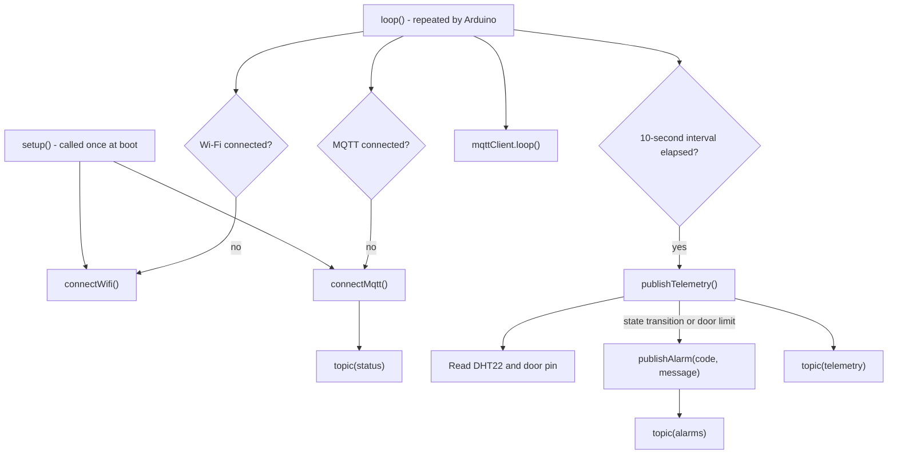

# Wokwi ESP32 Device

This directory contains the simulated board wiring (`diagram.json`), firmware (`sketch.ino`), and required Arduino libraries (`libraries.txt`). The ESP32 uses GPIO 15 for the DHT22 data line and GPIO 27 for the door push button; the button is read with `INPUT_PULLUP`.

## Wokwi setup

1. Open the saved [Cold Chain IoT Gateway project](https://wokwi.com/projects/481333516199647233), or create an ESP32 project at `https://wokwi.com/projects/new/esp32`.
2. For a new project, copy `sketch.ino` and `diagram.json` and install each library listed in `libraries.txt`.
3. Run the simulation, adjust the DHT22 temperature or humidity, and press `D` to open or close the door. The Serial Monitor reports Wi-Fi and MQTT connection attempts.

The default sketch connects to `broker.hivemq.com:1883` through Wokwi's free
Public Gateway. It uses device ID `esp32-ccgw-dk-hb`; the local Mosquitto bridge
subscribes only to that topic namespace and forwards messages to Node-RED. Keep
the Node-RED broker host set to `mosquitto`. This route needs no Wokwi paid
plan, but HiveMQ and Wokwi's Public Gateway are shared services, the MQTT
traffic is unencrypted, and public-gateway traffic may be monitored. Use only
synthetic demo data.

## Live verification status

The earlier HTTP 503 from `wss://netwi.wokwi.com/` was not reproduced in the
latest runs. The standalone probe returned from `WiFi.begin()`, obtained IP
`10.10.0.2`, and opened TCP to `broker.hivemq.com:1883`. The main firmware also
reported Wi-Fi and MQTT connected, but repeatedly logged `invalid DHT22
reading`. This points the current investigation at the sensor/read path rather
than a demonstrated network-route failure; it does not establish why the
earlier 503 occurred. No valid telemetry, dashboard update, alarm, or LWT has
yet been observed end to end. The HiveMQ-to-Mosquitto bridge was separately
verified using a synthetic message.

For a reproducible isolation test that checks Wi-Fi association and outbound
TCP to HiveMQ without `PubSubClient`, use the separate
[`network-diagnostic/README.md`](network-diagnostic/README.md) sketch in a
temporary Wokwi project.

## Firmware function map

| Function | Inputs and state | Calls, output, or side effects |
| --- | --- | --- |
| `topic(suffix)` | Suffix and fixed device ID | Returns `cold-chain/<device_id>/<suffix>`; used by MQTT connection and publish functions. |
| `connectWifi()` | Simulator Wi-Fi credentials | Starts association on Wokwi channel 6, reports progress, and blocks in 250 ms waits until connected; called by `setup()` and `loop()`. |
| `connectMqtt()` | Wi-Fi-connected MQTT client | Sets broker and 30 s keep-alive, registers retained QoS 1 offline LWT, logs retry state, and publishes retained online status. Called by `setup()` and `loop()`. |
| `publishAlarm(code, message)` | Alarm identifier and English description | Builds a JSON event and publishes non-retained to `topic("alarms")`; called by `publishTelemetry()`. |
| `publishTelemetry()` | DHT22 readings, door input, shared alarm state | Rejects invalid sensor reads, evaluates temperature transitions and sampled door duration, then publishes telemetry. Calls `publishAlarm()` and `topic()`. |
| `setup()` | Arduino boot lifecycle | Initializes serial, door input, DHT22, Wi-Fi, and MQTT in dependency order. |
| `loop()` | Arduino repeated lifecycle | Recovers connections, services MQTT, and schedules `publishTelemetry()` every 10 seconds. |

See [`../mosquitto/README.md`](../mosquitto/README.md) for the free bridge setup
and [`../docs/architecture.md`](../docs/architecture.md) for the full call
graph and MQTT payload contract.

## Change history

- Initial prototype: added DHT22 and door wiring, 10-second telemetry, thermal/door alarms, and retained MQTT LWT status.
- English documentation pass: translated serial errors, alarm messages, simulator labels, and code comments.
- Connectivity diagnostics: use Wokwi's documented Wi-Fi channel 6 and report Wi-Fi progress and MQTT retry state to Serial Monitor. A separate probe confirmed virtual Wi-Fi association and TCP reachability to HiveMQ; the main firmware connected to MQTT but reported invalid DHT22 readings.
