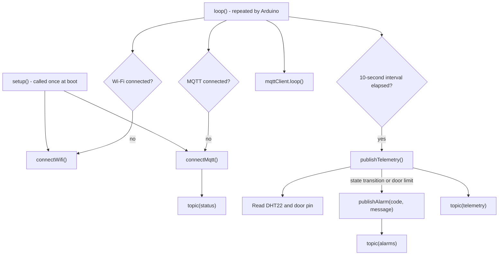

# Wokwi ESP32 Device

This directory contains the simulated board wiring (`diagram.json`), firmware (`sketch.ino`), and required Arduino libraries (`libraries.txt`). The DHT22 has four pins: connect `VCC` to `3V3`, `SDA` to ESP32 `D15` (GPIO 15), and `GND` to ground; leave `NC` unconnected. The door push button connects to `D27` (GPIO 27) and ground and is read with `INPUT_PULLUP`.

## Wokwi setup

1. Open the saved [Cold Chain IoT Gateway project](https://wokwi.com/projects/481333516199647233), or create an ESP32 project at `https://wokwi.com/projects/new/esp32`.
2. For a new project, copy `sketch.ino` and `diagram.json` and install each library listed in `libraries.txt`.
3. Run the simulation, adjust the DHT22 temperature or humidity, and press `D` to open or close the door. The Serial Monitor reports Wi-Fi and MQTT connection attempts.

The default sketch connects to `broker.hivemq.com:1883` through Wokwi's free
Public Gateway. It uses device ID `esp32-ccgw-dk-hb`; the local Mosquitto bridge
subscribes only to that topic namespace and forwards messages to Node-RED. Keep
the Node-RED broker host set to `mosquitto`. This route needs no Wokwi paid
plan, but HiveMQ and Wokwi's Public Gateway are shared services, the MQTT
traffic is unencrypted, and public-gateway traffic may be monitored. Use only
synthetic demo data.

## Live verification status

An earlier HTTP 503 from `wss://netwi.wokwi.com/` was not reproduced by the
standalone probe, which obtained IP `10.10.0.2` and opened TCP to
`broker.hivemq.com:1883`. The DHT22 issue was a separate wiring-definition
problem: the old `esp:15` endpoint did not produce a visible/electrical SDA
connection in Wokwi. The diagram now uses the documented
`wokwi-esp32-devkit-v1` board and `esp:D15`/`esp:D27` pin names. The recommended
`DHT sensor library for ESPx` is also in use. A sensor-only simulation now
reports `status=OK`, `temperature_c=5.00`, and `humidity_pct=55.00` repeatedly.

An earlier full-firmware attempt received HTTP 503 during Wi-Fi association.
In a later run, while the Wokwi project remained in the foreground, the
firmware connected to HiveMQ and a local Mosquitto subscriber captured three
Wokwi-originated telemetry messages: 5.00 C, 55.00% humidity, door closed, at
uptimes 92, 102, and 112 seconds. Node-RED displayed the 5 C / 55% readings
with the gateway online. After the simulation was stopped, the retained
status and dashboard showed offline. The exact Last Will detection delay was
not measured, and the successful short run does not establish long-duration
reliability.

The optional Wokwi Private Gateway was not used for this verification. Although
the user reported activating Pro, selecting **Enable Private Gateway** in the
signed-in Wokwi page opened an upgrade prompt. The verified demonstration
therefore used the existing Public Gateway -> HiveMQ -> Mosquitto bridge route.
The HiveMQ bridge and Node-RED alarm rules were also tested independently with
explicitly synthetic messages; those tests are not Wokwi-originated telemetry.

In a follow-up session, three restart attempts remained at
`Connecting to Wi-Fi` for approximately 10, 15, and 15 seconds. They were
stopped without new telemetry, and the cause remains undetermined. The last
simulation was left stopped.

For a reproducible isolation test that checks Wi-Fi association and outbound
TCP to HiveMQ without `PubSubClient`, use the separate
[`network-diagnostic/README.md`](network-diagnostic/README.md) sketch in a
temporary Wokwi project.

For a sensor-only check that excludes Wi-Fi and MQTT, see
[`dht-diagnostic/README.md`](dht-diagnostic/README.md).

## Firmware function map

| Function | Inputs and state | Calls, output, or side effects |
| --- | --- | --- |
| `topic(suffix)` | Suffix and fixed device ID | Returns `cold-chain/<device_id>/<suffix>`; used by MQTT connection and publish functions. |
| `connectWifi()` | Simulator Wi-Fi credentials | Starts association on Wokwi channel 6, reports progress, and blocks in 250 ms waits until connected; called by `setup()` and `loop()`. |
| `connectMqtt()` | Wi-Fi-connected MQTT client | Sets broker and 30 s keep-alive, registers retained QoS 1 offline LWT, logs retry state, and publishes retained online status. Called by `setup()` and `loop()`. |
| `publishAlarm(code, message)` | Alarm identifier and English description | Builds a JSON event and publishes non-retained to `topic("alarms")`; called by `publishTelemetry()`. |
| `publishTelemetry()` | DHT22 readings, door input, shared alarm state | Rejects invalid sensor reads, evaluates temperature transitions and sampled door duration, then publishes telemetry. Calls `publishAlarm()` and `topic()`. |
| `setup()` | Arduino boot lifecycle | Initializes serial, door input, DHT22, Wi-Fi, and MQTT in dependency order. |
| `loop()` | Arduino repeated lifecycle | Recovers connections, services MQTT, and schedules `publishTelemetry()` every 10 seconds. |

See [`../mosquitto/README.md`](../mosquitto/README.md) for the free bridge setup
and [`../docs/architecture.md`](../docs/architecture.md) for the full call
graph and MQTT payload contract.

## Change history

- Initial prototype: added DHT22 and door wiring, 10-second telemetry, thermal/door alarms, and retained MQTT LWT status.
- English documentation pass: translated serial errors, alarm messages, simulator labels, and code comments.
- Connectivity diagnostics: use Wokwi's documented Wi-Fi channel 6 and report Wi-Fi progress and MQTT retry state to Serial Monitor. A separate probe confirmed virtual Wi-Fi association and TCP reachability to HiveMQ.
- DHT22 wiring fix: the former `esp:15` endpoint did not connect the SDA pin in Wokwi. The board and pin references now match Wokwi's ESP32 DHT22 example, and the isolated sensor test repeatedly reads 5.00 C and 55.00% humidity.
