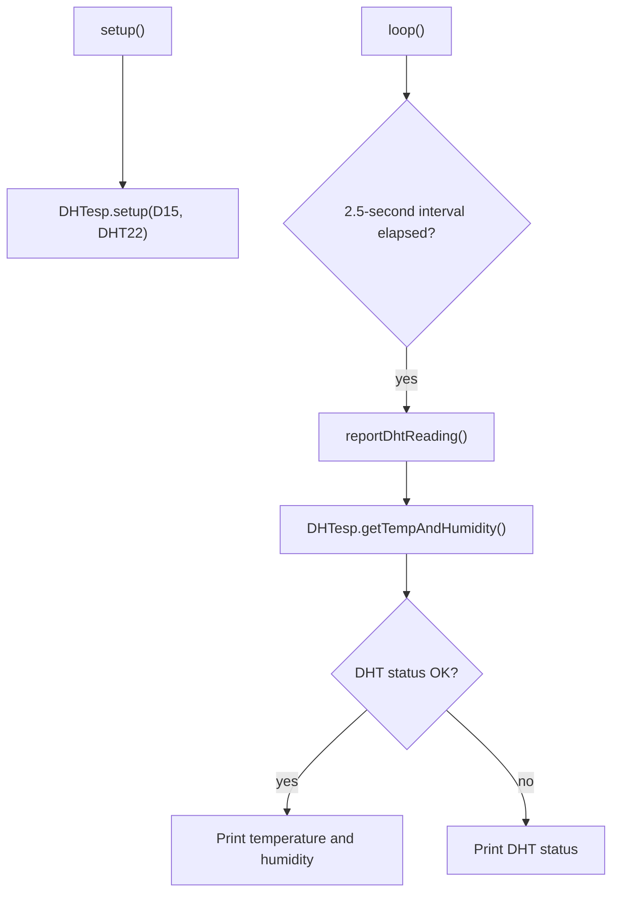

# DHT22 Diagnostic

This sensor-only Wokwi sketch isolates DHT22 wiring and reads from Wi-Fi,
MQTT, the Mosquitto bridge, and Node-RED. It uses the ESP32-specific library
recommended by Wokwi.

## Function path



## Run the isolated test

1. Create a separate ESP32 Wokwi project.
2. Use the main project's [`diagram.json`](../diagram.json), which includes the
   ESP32, DHT22, and door button. Ensure the DHT22 `SDA` pin connects to
   `esp:D15`, `VCC` to `3V3`, and `GND` to `GND`; leave `NC` unconnected.
3. Use this folder's `sketch.ino` and `libraries.txt`.
4. Start the simulation and inspect the Serial Monitor at 115200 baud.

Expected output includes `DHT_DIAG: status=OK` plus temperature and humidity.
`TIMEOUT` indicates that the ESP32 did not receive a response on its data pin.

## Observed result

With the corrected `wokwi-esp32-devkit-v1` diagram and `D15` SDA connection,
the isolated simulation repeatedly printed:

```text
DHT_DIAG: status=OK temperature_c=5.00 humidity_pct=55.00
```

The prior diagram used `esp:15`; Wokwi did not render that SDA wire, leaving
the data pin electrically disconnected. The middle `NC` pin is intentionally
not connected; the other middle pin, `SDA`, must connect to `D15`.

Wokwi's [DHT22 reference](https://docs.wokwi.com/parts/wokwi-dht22) documents
the pin names and recommends the ESP32-specific DHT library. Its
[ESP32 DHT22 example](https://wokwi.com/projects/322410731508073042) uses the
`esp:D15` pin reference.
