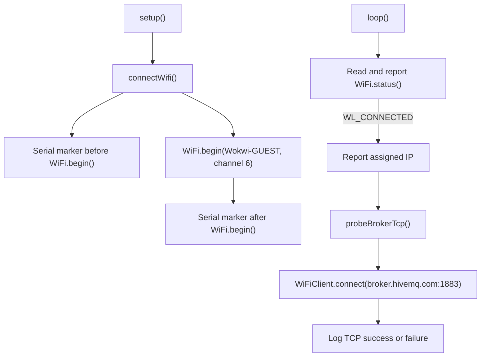

# Wokwi Network Diagnostic

This standalone sketch isolates the simulated device's Wi-Fi association and
outbound TCP route from the project's DHT22, `PubSubClient`, MQTT topics,
Mosquitto bridge, and Node-RED flow. It uses no third-party Arduino libraries.

## Function path

## Run it without changing the main project

1. Open a separate [new ESP32 Wokwi project](https://wokwi.com/projects/new/esp32).
2. Replace its `sketch.ino` with this file. Keep the default ESP32 diagram;
   no DHT22 or door switch is required.
3. Start the simulation and inspect the Serial Monitor at 115200 baud.
4. Do not save this probe over the public demonstration project.

## Interpret the markers

| Serial output | What it establishes |
| --- | --- |
| No `PROBE: firmware started` | The sketch has not reached `setup()`, or the simulator/serial monitor is not running correctly. |
| `calling WiFi.begin()` without `WiFi.begin() returned` | The Wi-Fi startup call has not returned; investigate the Wokwi simulator/gateway path before MQTT code. |
| `WiFi.begin() returned` with a repeating non-connected status | The sketch runs, but simulated Wi-Fi association has not completed. |
| `wifi_status` corresponds to `WL_CONNECTED`, followed by an assigned IP | The ESP32 simulation has joined Wokwi's virtual access point. |
| `TCP connection succeeded` | The simulated ESP32 resolved HiveMQ and opened TCP port 1883 through its configured gateway. This does not prove MQTT CONNECT, publish, bridge delivery, or Node-RED behavior. |
| `TCP connection failed` | The device is associated with Wi-Fi but the DNS/TCP route to HiveMQ failed. Isolate the gateway/network path before debugging MQTT flow logic. |

This is a diagnostic probe, not a production client. The successful WebSocket
upgrade test from the host is a separate check. This probe went further: it
confirmed that the simulated ESP32 associated with Wokwi's virtual Wi-Fi,
received IP `10.10.0.2`, and opened TCP to HiveMQ on port 1883. The probe does
not test MQTT CONNECT/publish, bridge delivery, Node-RED, sensor wiring, or the
cause of the earlier HTTP 503. For the DHT22 wiring and driver test, see
[`../dht-diagnostic/README.md`](../dht-diagnostic/README.md).

## Observed result

| Stage | Latest observed output | Conclusion |
| --- | --- | --- |
| Firmware startup | `PROBE: firmware started` | The diagnostic sketch reached `setup()`. |
| Wi-Fi API call | `PROBE: WiFi.begin() returned` | The startup call returned; it did not stall in `WiFi.begin()`. |
| Association | Assigned IP `10.10.0.2`; Wokwi UI showed `WiFi: Connected to Wokwi-GUEST (Public IoT Gateway)` | The ESP32 simulator associated with Wokwi's virtual access point. |
| Outbound route | `PROBE: TCP connection succeeded` to `broker.hivemq.com:1883` | DNS and TCP connectivity from the simulated ESP32 to HiveMQ worked in this run. |
| Main firmware before the wiring correction | MQTT connected, then repeated invalid DHT22 readings | The DHT22 SDA endpoint was not connected; the corrected wiring is verified separately by the sensor-only diagnostic. |

These are successful observations from individual runs, not a guarantee of
continuous gateway availability. The standalone probe did not reproduce the
HTTP 503, but a later full firmware run did; the cause remains unknown.
